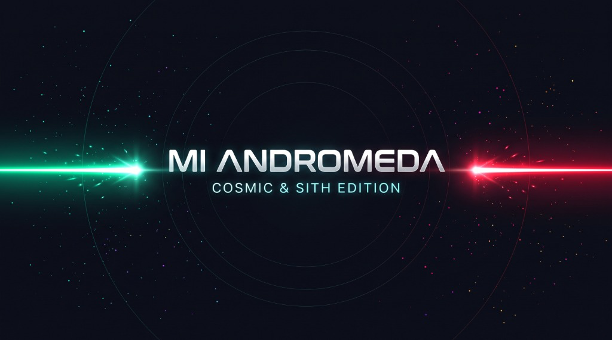
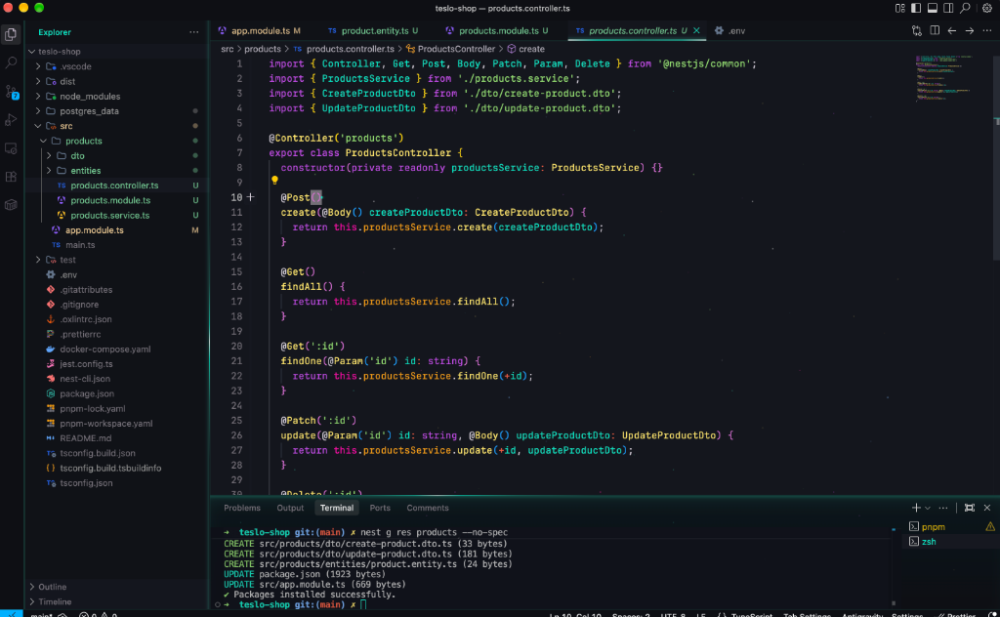
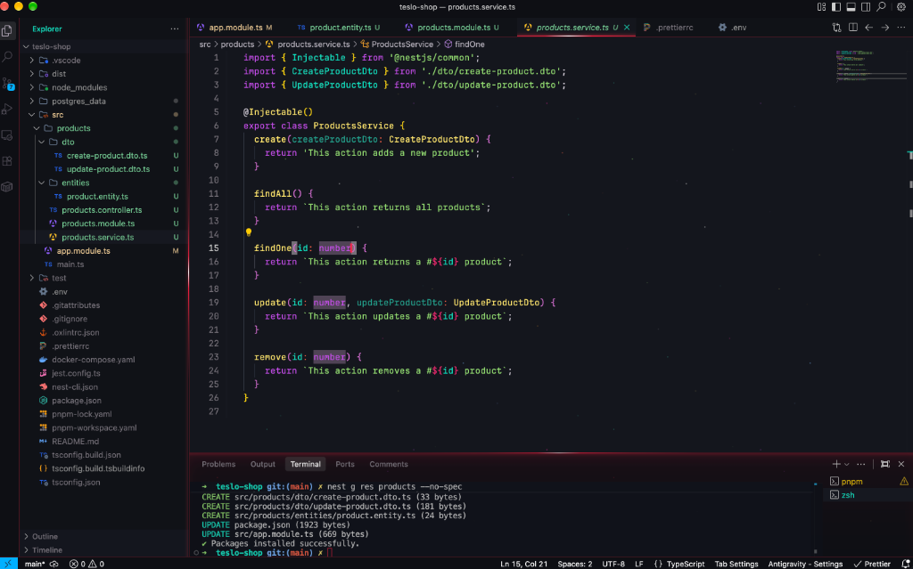

# Mi Andromeda — Cosmic & Sith Edition

Tema oscuro de espacio profundo inspirado en [Andromeda de Eliver Lara](https://github.com/EliverLara/Andromeda), diseñado y optimizado para **Antigravity IDE** y editores compatibles con **VS Code**.

Combina un fondo cósmico profundo (`#14161D`), contraste jerárquico en paneles (`#101217` y `#0E0F14`), resaltado semántico optimizado para **JavaScript / TypeScript** y dos ediciones con efectos luminosos de bajo consumo en GPU.

---

## ✨ Variantes incluidas

### 1. Mi Andromeda *(Cosmic Cyan — `#00e8c6`)*
Edición principal con acentos, bordes láser, resplandor de terminal y cursor en verde/cian neón (`#00e8c6`).

---

### 2. Mi Andromeda Sith *(Crimson Laser — `#ff1e42`)*
Conserva intactos el fondo cósmico (`#14161D`) y toda la paleta de sintaxis de **Mi Andromeda**, transformando únicamente los bordes luminosos, el resplandor de la terminal y el cursor láser a rojo Sith (`#ff1e42`).

---

## 🚀 Características principales

- **Fondo de espacio profundo (`#14161D`)**: Contraste limpio entre el editor de código, el explorador de archivos (`#101217`) y las barras exteriores (`#0E0F14`), sin línea activa intrusiva.
- **Sintaxis optimizada para JS / TS**: Diferenciación clara entre claves de objetos, propiedades, tipos, decoradores, parámetros y valores mediante `semanticHighlighting` y reglas TextMate depuradas.
- **Efectos Cosmic Andromeda (Opcional en macOS)**:
  - Partículas finas de polvo estelar con destellos suaves acelerados por hardware (`opacity` con mesetas de reposo).
  - Bordes con haz láser continuo (`transform: translate3d`) que cambian automáticamente entre verde/cian (`#00e8c6`) y rojo Sith (`#ff1e42`) al alternar de tema.
  - Terminal integrada con efecto de cristal cósmico translúcido.
  - Auto-pausa inteligente (`0%` de uso de GPU/CPU cuando la ventana está en segundo plano o los paneles están ocultos).

---

## 📦 Instalación

1. Busca **Mi Andromeda** en la pestaña de Extensiones de Antigravity IDE (Open VSX), o instala el paquete `.vsix` desde **`Extensions: Install from VSIX...`**.
2. Abre la paleta de comandos (`Cmd + Shift + P` / `Ctrl + Shift + P`), selecciona **`Preferences: Color Theme`** y elige:
   - **Mi Andromeda**
   - **Mi Andromeda Sith**

---

## Credits & License

Personalización mantenida por **Dante**. Basada en [Andromeda](https://github.com/EliverLara/Andromeda) de Eliver Lara y su [fork para Open VSX](https://github.com/FelixIcaza/Andromeda).

Licencia [MIT](LICENSE.md).
